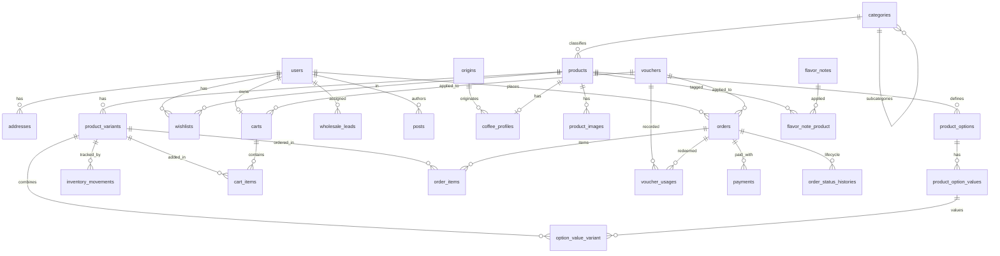

# Skema Database & Relasi ERD — Kopi App

Aplikasi web e-commerce kopi & portofolio ritel multikategori (B2C) + Wholesale (B2B).

## Arsitektur Data Inti

1. **Pemisahan Induk & Varian (SKU)**
   - `products`: Menyimpan informasi deskriptif umum, kategori, tipe produk, SEO, status, dan soft delete.
   - `product_variants`: Menyimpan SKU, harga (`price`, `compare_at_price`, `cost_price`), stok, berat, batas stok rendah, status aktif, dan soft delete.
   - Semua nominal uang disimpan dalam tipe `unsignedBigInteger` integer Rupiah tanpa desimal.

2. **Opsi Dinamis (Weight / Grind Size / Size)**
   - `product_options` (mis. *Berat*, *Grind Size*, *Ukuran*)
   - `product_option_values` (mis. *250g*, *1kg*, *Fine*, *Medium*, *Whole Bean*, *XL*)
   - Pivot `option_value_variant` menghubungkan kombinasi opsi ke SKU spesifik di `product_variants`.

3. **Atribut Spesifik Kopi**
   - `coffee_profiles`: Relasi One-to-One dengan `products` (`product_id` unik), `origin_id` (FK `origins`), proses, `roast_level` (enum), varietas, produser, ketinggian (masl), serta skor rasa (acidity, body, sweetness: skala 1-5).
   - `flavor_note_product`: Pivot many-to-many antara `products` dan `flavor_notes`.

4. **Inventory Movement Ledger**
   - `inventory_movements`: Ledger transaksi perubahan stok fisik.
   - Tipe movement: `purchase`, `sale`, `adjustment`, `return`, `cancel`.
   - Menggunakan relasi polimorfik `reference_type` & `reference_id` (mis. Order, Batch Opname, dll).
   - Perubahan dieksekusi secara atomik (`lockForUpdate` + `DB::transaction`).

5. **Transaksi & Checkout (Termasuk Guest Checkout)**
   - `orders`: `user_id` bernilai `nullable` untuk mendukung guest checkout dengan `guest_email` dan `guest_phone`.
   - Snapshot alamat pengiriman disimpan langsung di baris order agar riwayat transaksi tidak terpengaruh perubahan alamat akun user.
   - `order_items`: Menyimpan snapshot nama produk, nama varian, SKU, harga, dan berat pada saat transaksi terjadi.
   - `payments`: Status pembayaran, gateway (Midtrans, Xendit, QRIS, dsb.), riwayat payload response.
   - `order_status_histories`: Riwayat perubahan siklus hidup pesanan (`from_status`, `to_status`, catatan).

6. **Promosi & Voucher**
   - `vouchers`: Mendukung diskon persentase, nominal tetap, dan gratis ongkir, batas minimal belanja, serta batas kuota pemakaian per user/guest email.
   - `voucher_usages`: Log pemakaian voucher per pesanan dan user.

7. **Konten Brand & Wholesale**
   - `posts`: Artikel jurnal, story brand, dan roastery journey.
   - `banners`: Media promosi carousel/hero dengan penjadwalan tanggal tayang.
   - `wholesale_leads`: Formulir kontak prospek B2B / kemitraan cafe & resto.

---

## Diagram Relasi Tabel (Mermaid ERD)

